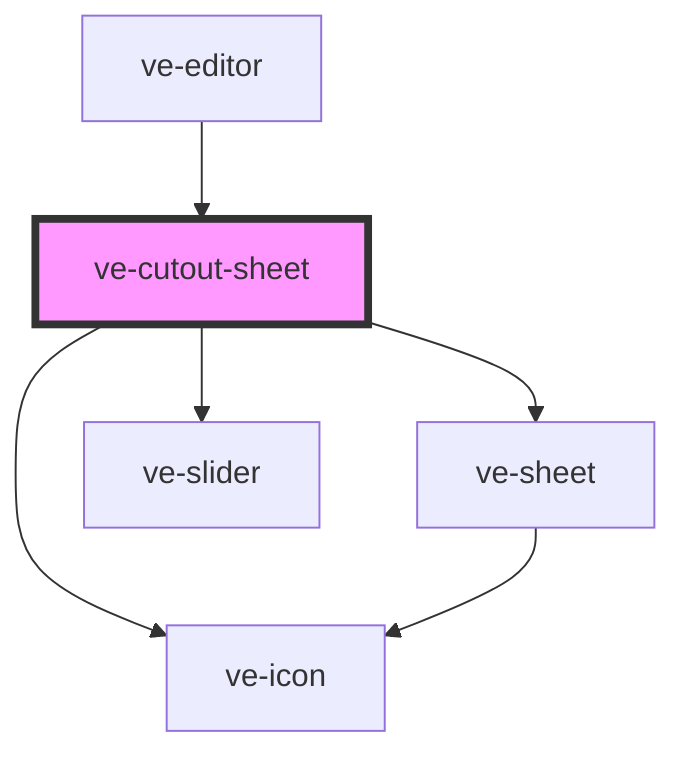

# ve-cutout-sheet

<!-- Auto Generated Below -->

## Overview

A clip's or a photo's Cutout: its background taken away, and what goes behind and round what is
left.

The matte is found by the host's segmenter ([EditorMediaHost.findMatte]), which `EditorMedia` starts
as soon as the clip or photo has a cutout - opening this sheet puts one on - so the first tab says
how far that has got, stage by stage, until it is done; the preview then reveals the cutout. A photo
looked at as it went on (the offer over the preview) answers at once.

Subject: what is kept - whatever stands out, or only the people - Compare, which holds the original
on the preview while it is pressed, and the edge: how soft, and where it sits. Style: a colour behind
the subject on a clip, a line round it in one of the swatches' colours, and on a photo a shadow under it.

Every control writes the manifest live through the store, as every other sheet does; a slider's drag
lands as one undo step by its coalesce key, and a tap is a step of its own. The none button is Remove
cutout, which gives the background back and closes the sheet.

## Properties

| Property           | Attribute | Description | Type            | Default     |
| ------------------ | --------- | ----------- | --------------- | ----------- |
| `ctx` _(required)_ | --        |             | `EditorContext` | `undefined` |

## Dependencies

### Used by

 - [ve-editor](../ve-editor)

### Depends on

- [ve-sheet](../ve-sheet)
- [ve-icon](../ve-icon)
- [ve-slider](../ve-slider)

### Graph

----------------------------------------------

*Built with [StencilJS](https://stenciljs.com/)*
