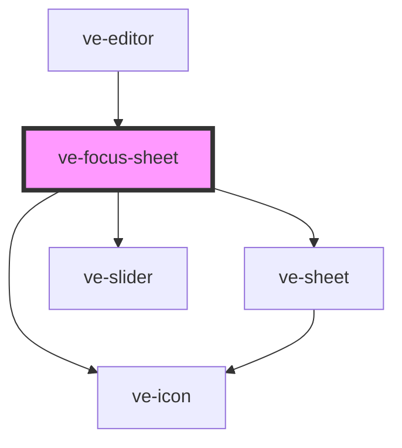

# ve-focus-sheet

<!-- Auto Generated Below -->

## Overview

A clip's Focus: which of its subjects stay sharp while the rest of the picture is softened, greyed
or darkened, and where in the clip the focus moves from one subject to another.

The subjects are found by the host's segmenter ([EditorMediaHost.findSubjects]), which `EditorMedia`
starts as soon as the clip has a focus - opening this sheet puts one on - so the first tab says how
far that has got until it is done. Then each subject has a chip, in the colour and number it is
outlined in on the preview, where a tap on the person does what a tap on their chip does.

WHICH subjects a tap changes is the choice in effect at the playhead: the clip's own until its first
change, a change's from its time on. "Change here" makes a change at the playhead for the next taps
to fill, and a change's chip moves the playhead to it. The look is one for the whole clip.

Every control writes the manifest live through the store, as every other sheet does; a slider's
drag lands as one undo step by its coalesce key, and a tap is a step of its own. The none button is
Remove focus, which takes the focus off and closes the sheet.

## Properties

| Property           | Attribute | Description | Type            | Default     |
| ------------------ | --------- | ----------- | --------------- | ----------- |
| `ctx` _(required)_ | --        |             | `EditorContext` | `undefined` |

## Dependencies

### Used by

 - [ve-editor](../ve-editor)

### Depends on

- [ve-sheet](../ve-sheet)
- [ve-icon](../ve-icon)
- [ve-slider](../ve-slider)

### Graph

----------------------------------------------

*Built with [StencilJS](https://stenciljs.com/)*
