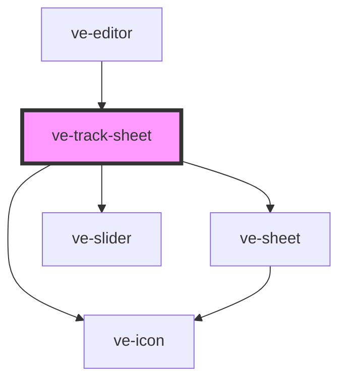

# ve-track-sheet

<!-- Auto Generated Below -->

## Overview

Track: a text, a sticker or a photo pinned to something in the footage, so it moves with it.

One thing to do and one button to do it with. The sheet opens with a box on the picture round the
layer - most layers are put on or beside what they are about - which the customer drags onto the thing
(a tap moves it there, a corner or a pinch sizes it), and Track follows it through the layer's time on
screen, both ways from the frame the box is on. The run is watched on the picture rather than waited
for: the box rides along the footage as it is read, and the finished track plays itself back once.

Tracked, the sheet is the few choices a track has - whether the layer grows and turns with the thing,
and how smooth its path is - and the box on the picture is the way to mend it: scrubbed to where it
slipped and dragged back onto the thing, it tracks again from there and keeps everything before.

Every control writes the manifest through the store, as every sheet does. The none button takes the
track off and leaves the layer where it is; the tick is done, and a run still going keeps what it found.

## Properties

| Property           | Attribute | Description | Type            | Default     |
| ------------------ | --------- | ----------- | --------------- | ----------- |
| `ctx` _(required)_ | --        |             | `EditorContext` | `undefined` |

## Dependencies

### Used by

 - [ve-editor](../ve-editor)

### Depends on

- [ve-sheet](../ve-sheet)
- [ve-icon](../ve-icon)
- [ve-slider](../ve-slider)

### Graph

----------------------------------------------

*Built with [StencilJS](https://stenciljs.com/)*
