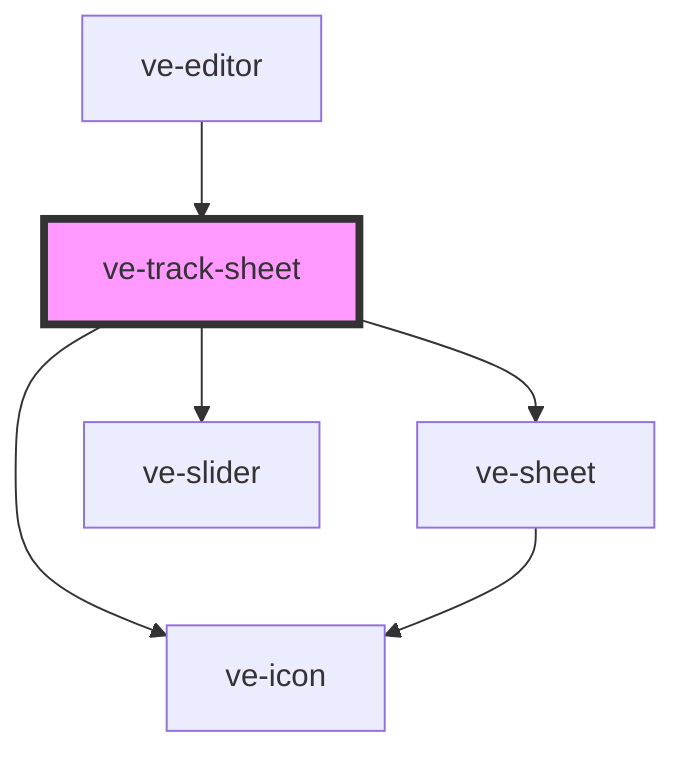

# ve-track-sheet

<!-- Auto Generated Below -->

## Overview

Track: something in the footage followed, a layer of its own that texts, stickers and photos are pinned
to so they move with it.

The sheet is where a track is made, looked at and mended, and it opens from three places: the Track tool
on the main row (a new track), the Track tool on a text, sticker or photo (the track the layer follows,
or one for it to follow), and a track's own row. It shows one of five faces, the first that applies:

 - A run under way: how far it has got, and Stop, which keeps what it found.
 - Choosing: a layer that follows nothing, on a post that has tracks, picks one of them - pinned where
   it is drawn now - or New track.
 - Aiming: the box on the picture, which a tap or a drag puts on the thing, and Track. The people the
   finder found light up on the picture, where a tap on one aims at them; this face only offers to
   look for them, and says how that went.
 - Fixing: the shown track's box dragged off its path. Fix track follows the thing again from this
   frame, both ways, until each way meets the old path.
 - The track: how sure it is, how smooth its path is and, on a layer that follows it, whether the layer
   grows and turns with the thing - and on its Look tab, the look it puts on the thing and how strong.

A shown track's name heads the body rather than the frame: `ve-sheet` takes its heading as a string,
and the name is a button that becomes a field - on a tap, or from Rename on the track's row, which opens
the sheet with `trackRenaming` set.

The sheet's height depends on whether it is open on a layer and on nothing else, never on the face:
the picture above it is what the box is dragged on, and a sheet that grew when the box left the track
resized the picture under the finger that was dragging it. The stylesheet has the arithmetic.

Every control writes the manifest through the store, as every sheet does, and the store gives the
haptics. The none button takes a layer off its track (Remove tracking) or, with no layer, the track off
the post (Remove track); the tick is done, and a run still going keeps what it found.

## Properties

| Property           | Attribute | Description | Type            | Default     |
| ------------------ | --------- | ----------- | --------------- | ----------- |
| `ctx` _(required)_ | --        |             | `EditorContext` | `undefined` |

## Dependencies

### Used by

 - [ve-editor](../ve-editor)

### Depends on

- [ve-sheet](../ve-sheet)
- [ve-icon](../ve-icon)
- [ve-slider](../ve-slider)

### Graph

----------------------------------------------

*Built with [StencilJS](https://stenciljs.com/)*
